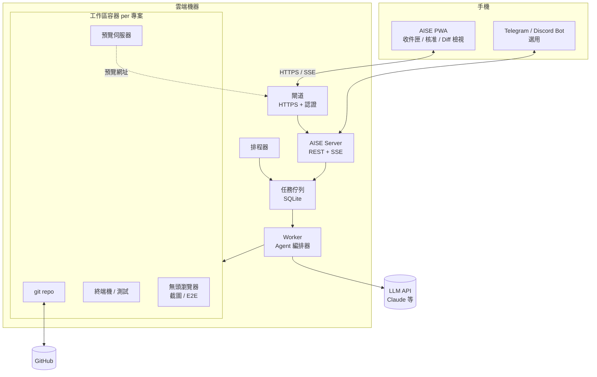
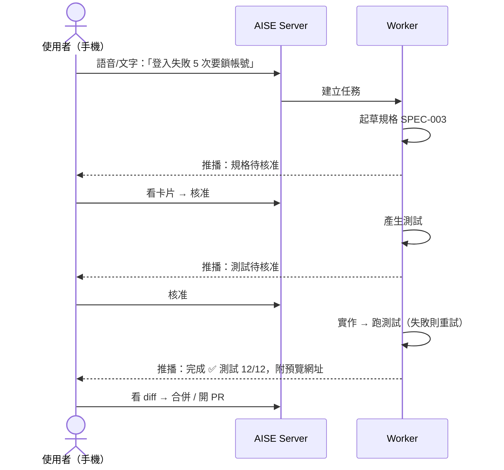

# AISE 雲端模式規劃：用手機開發軟體

> 版本：v0.1（2026-11-03）・狀態：草案・上層文件：[plan.md](plan.md)

## 1. 目標

**沒有電腦也能開發軟體。** 使用者在雲端機器（VPS、家用伺服器、雲端主機）上架設 AISE，平常只用手機下指令、看進度、核准變更。

具體要做到：

1. 一行指令就能在一台 Linux 機器上架好（`docker compose up` 或安裝腳本）
2. 手機瀏覽器打開就能用（PWA，可加入主畫面，不用上架 App Store）
3. 任務在雲端持續執行，**關掉手機也不會中斷**
4. 需要人類決定時推播通知，手機上一鍵核准或退回
5. 手機上能看懂結果：diff、測試報告、預覽網址、截圖

## 2. 參考：Grok Bot 的設計

xAI 在 2026-08 推出 Grok Bot（beta），有幾個設計很值得參考：

| Grok Bot 的做法 | AISE 的對應設計 |
|-----------------|-----------------|
| 每個 Bot 有一台專屬、持久的雲端電腦（瀏覽器、檔案系統、終端機） | 每個專案一個**持久工作區容器**，裝好 repo 與開發環境 |
| 關掉 App 之後 Bot 仍持續工作 | 任務由**伺服器端常駐程式**執行，與客戶端連線無關 |
| 手機上可以開始工作、回答問題、核准步驟、檢視結果 | 手機介面以**任務收件匣 + 核准卡片**為核心，不在手機上打字寫程式 |
| 手機與桌面共用同一組 Bot、對話、排程與連接器 | 所有狀態存在伺服器，**任何裝置登入看到的都一樣** |
| Routines（排程任務） | 排程任務，例如每晚跑測試、每週更新相依套件 |
| Connectors（外部服務連接） | GitHub、Telegram/Discord、Email 等整合，透過 MCP 擴充 |

兩者的關鍵差異：Grok Bot 是託管服務，AISE 要能**自己架**（self-hosted）：程式碼與 API 金鑰留在自己的機器上，模型用哪家也由自己決定。

## 3. 架構

### 3.1 元件

| 元件 | 職責 |
|------|------|
| **AISE Server** | 對外 API，管理專案、任務、使用者、推播訂閱；SSE 即時串流 Agent 進度 |
| **任務佇列** | 任務持久化；伺服器重開機後能從中斷點繼續 |
| **Worker** | 執行 [plan.md](plan.md) 中的 Agent 流程；遇到核准點就暫停任務，並發出通知 |
| **工作區容器** | 每個專案一個 Docker 容器，隔離檔案系統與網路，限制 CPU / 記憶體；Agent 只能在容器內執行指令 |
| **預覽伺服器** | 把容器內的 dev server 透過 `https://<task>.preview.<domain>` 暴露，手機直接點開看成果 |
| **排程器** | cron 形式的例行任務 |

## 4. 手機操作體驗

手機螢幕小、打字慢，所以設計原則是：**手機負責「決定」，雲端負責「做」。**

### 4.1 典型流程

### 4.2 畫面

| 畫面 | 內容 |
|------|------|
| **收件匣** | 依狀態列出任務：待核准、執行中、完成、失敗。待核准置頂 |
| **任務詳情** | 時間軸呈現 Agent 每一步，可展開看指令輸出；底部固定輸入框可追加指示 |
| **核准卡片** | 摘要 + 「核准 / 退回並附意見 / 修改」三個大按鈕 |
| **Diff 檢視** | 單欄（unified）diff、可左右滑動切換檔案；長檔案預設摺疊未變更區塊 |
| **測試報告** | 通過/失敗數、失敗測試的錯誤訊息、覆蓋率 |
| **預覽** | 內嵌 iframe 或另開分頁看 web app；附 Agent 自動拍的截圖 |
| **終端機** | 備用的完整終端機（xterm.js），給需要手動處理的時候 |

### 4.3 輸入方式

- **語音輸入**：用手機內建語音轉文字，口述需求即可
- **快速指令**：常用操作做成按鈕，例如「重跑測試」、「開 PR」、「回滾」
- **聊天機器人**：選用的 Telegram / Discord Bot，在聊天軟體裡收通知、回覆核准

## 5. 安全

雲端機器 24 小時對外連線，又握有程式碼與 API 金鑰，安全必須從一開始就設計進去。

| 風險 | 對策 |
|------|------|
| 別人登入你的 AISE | Passkey（WebAuthn）登入，不使用密碼；也可以只開放 Tailscale 內網連線 |
| 不想開對外連接埠 | 支援 Cloudflare Tunnel / Tailscale，機器不需要公開 IP |
| Agent 執行危險指令 | 指令只在容器內執行；預設阻擋 `git push --force`、刪除 repo 等高風險操作，必須人類核准 |
| 金鑰外洩 | API 金鑰加密存放，不放進工作區容器；改由伺服器代理 LLM 呼叫 |
| 容器對外亂連 | 容器網路預設白名單（套件鏡像、GitHub、LLM API） |
| 成本失控 | 每個任務與每月 token 上限，到達上限暫停並通知 |

## 6. 部署方式

| 方式 | 適合 | 說明 |
|------|------|------|
| `docker compose up` | 大多數人 | 任何 Linux VPS（2 vCPU / 4 GB RAM 起） |
| 一鍵安裝腳本 | 新手 | `curl ... \| sh`，自動裝 Docker、設定 Tunnel、建立第一個帳號 |
| 雲端範本 | 不想碰終端機的人 | 提供 Fly.io / Railway / GCP 等平台的部署範本（按一下按鈕即可部署） |
| 本機模式 | 有電腦的人 | 同一套 Server 跑在筆電上，手機透過 Tailscale 連回 |

**沒有電腦的人怎麼完成第一次設定？** 用手機瀏覽器開啟雲端平台的部署按鈕（或雲端主機商網頁版的 SSH 主控台貼上安裝腳本），部署完成後開啟網址、用 Passkey 註冊，全程不需要電腦。

## 7. 技術選型（雲端模式新增）

| 項目 | 選擇 | 理由 |
|------|------|------|
| Server | Node.js + Fastify | 與 core 同語言 |
| 即時串流 | SSE + `Last-Event-ID`（斷線自動重連、補傳事件） | 手機網路不穩；比 WebSocket 簡單，走一般 HTTPS |
| 前端 | PWA（Svelte 或 React）+ Web Push | 免上架、可推播（iOS 16.4+ 加入主畫面後支援） |
| 容器 | Docker（之後可換 gVisor / Firecracker 加強隔離） | 普及、好部署 |
| 終端機 | xterm.js | 標準方案 |
| 認證 | WebAuthn Passkey | 手機原生支援、免記密碼 |

## 8. 對原規劃的影響

使用者手上**沒有電腦**，所以雲端模式不能放到最後才做，Server 與手機介面要提早到 MVP 內。調整後的里程碑：

| 里程碑 | 原內容 | 調整 |
|--------|--------|------|
| M0 基礎 | CLI 骨架、LLM Provider | **加入 AISE Server + 任務佇列**；CLI 改為 Server 的一種客戶端 |
| M0.5 雲端 | — | **新增**：工作區容器、PWA 收件匣與核准卡片、Web Push、Passkey、docker compose 部署 |
| M1 追溯 | 不變 | 手機上可看追溯矩陣 |
| M2 測試優先 | 不變 | 每個核准點都推播到手機 |
| M5 整合 | MCP、VS Code、儀表板 | 加入 Telegram Bot、排程任務、預覽網址 |

**新的 MVP = M0 + M0.5 + M1 + M2**，約 10 週。完成後可以只用一支手機走完「說出需求 → 核准規格 → 核准測試 → 看預覽 → 合併」。

## 參考資料

- [Grok Bot 官方文件](https://docs.x.ai/grok-bot/overview)
- [Grok Bot 行動版文件](https://docs.x.ai/grok-bot/mobile)
- [A deep dive into Grok Bot](https://flaviocopes.com/grok-bot/)
