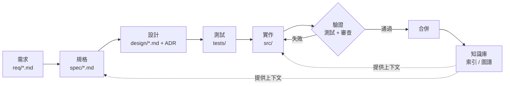
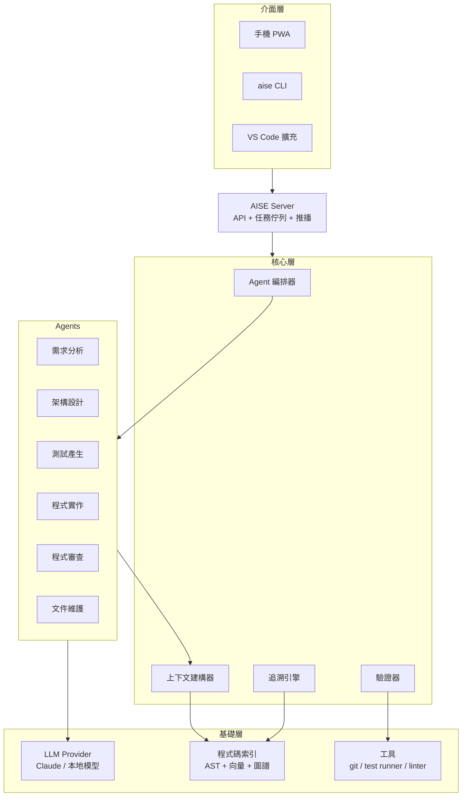
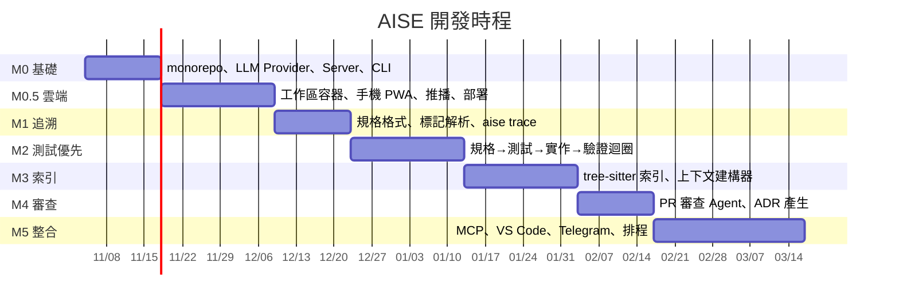

# AISE 專案規劃：AI 驅動的軟體工程 IDE

> 版本：v0.1（2026-11-03）・狀態：草案

## 1. 願景

**讓「規格」成為軟體開發的第一公民，讓 AI 負責把規格變成可驗證的程式碼。**

現在的 AI 寫程式工具（Copilot、Cursor、Claude Code……）多半聚焦在「寫程式」這一段，但軟體工程真正的成本在於：

- 需求模糊、反覆變更，程式與需求脫節
- 測試不足，AI 產生的程式「看起來對」但沒人能保證
- 架構決策散落在聊天紀錄裡，沒有留下來
- 程式碼越長越大，新人（和 AI）都看不懂全貌

AISE 的目標是把 **需求 → 設計 → 實作 → 測試 → 審查 → 維護** 整條鏈路串起來，每一步都由 AI 協助、由人類把關，而且每一步都**可追溯（traceable）**、**可驗證（verifiable）**。

## 2. 核心理念

| 理念 | 說明 |
|------|------|
| Spec-Driven | 先寫規格（Markdown + 驗收條件），程式由規格產生、以規格驗證 |
| Test as Contract | AI 產生程式前先產生測試；測試通過才算完成 |
| Human-in-the-Loop | AI 提案、人類核准；關鍵決策都留下紀錄（ADR） |
| Traceability | 每一行程式都能追到需求，每個需求都能找到程式與測試 |
| Local-first | 所有產物都是 repo 裡的純文字檔（Markdown / YAML / 程式碼），可 git diff、可 review |
| Model-agnostic | 透過 Provider 介面支援 Claude、本地模型等，不綁定單一廠商 |
| Cloud & Mobile | 可架在雲端機器上，用手機下指令、核准、看結果（見 [cloud.md](cloud.md)） |

## 3. 開發流程



每個箭頭都有一個對應的 AI Agent，人類在每個節點都可以檢視、修改、核准。

## 4. 系統架構



### 4.1 模組說明

| 模組 | 職責 |
|------|------|
| **AISE Server** | 常駐服務；所有客戶端（手機、CLI、VS Code）都透過它操作，任務在伺服器端持續執行 |
| **Agent 編排器** | 依流程階段呼叫對應 Agent，管理狀態機、重試與人類核准點 |
| **上下文建構器** | 依任務從索引挑出相關程式、規格、ADR，控制 token 預算 |
| **追溯引擎** | 解析 `@req REQ-012` 之類的標記，建立 需求↔規格↔測試↔程式 的關聯圖 |
| **驗證器** | 執行測試、型別檢查、lint、覆蓋率，把結果回饋給 Agent |
| **程式碼索引** | 用 tree-sitter 解析 AST，建立符號表、呼叫圖與語意向量 |
| **LLM Provider** | 統一的模型介面，支援串流、工具呼叫、prompt caching、成本統計 |

## 5. 產物格式（範例）

規格檔 `spec/login.md`：

```markdown
---
id: SPEC-003
req: [REQ-001, REQ-002]
status: approved
---
# 使用者登入

## 驗收條件
- [ ] AC-1：正確帳密 → 回傳 JWT，有效期 1 小時
- [ ] AC-2：錯誤密碼 5 次 → 鎖定帳號 15 分鐘
```

測試中以標記連回規格：

```ts
// @spec SPEC-003 AC-2
test('locks account after 5 failed attempts', () => { ... })
```

`aise trace` 即可產生覆蓋矩陣，找出「沒有測試的驗收條件」與「沒有需求來源的程式」。

## 6. 技術選型

| 項目 | 選擇 | 理由 |
|------|------|------|
| 語言 | TypeScript（Node.js） | 生態系完整，CLI 與 VS Code 擴充可共用程式碼 |
| 程式解析 | tree-sitter | 多語言 AST，速度快 |
| 索引儲存 | SQLite（含向量擴充） | 單檔、免架伺服器、符合 local-first |
| LLM | Anthropic SDK 為主，Provider 介面可擴充 | 工具呼叫與長上下文能力強 |
| Agent 協定 | MCP（Model Context Protocol） | 讓工具可被其他 AI 客戶端重用 |
| 測試 | Vitest | 快、與 TS 整合佳 |
| 套件管理 | pnpm monorepo | 多套件共用 |

### 6.1 目錄結構

```
aise/
├── packages/
│   ├── core/        # 編排器、追溯、驗證
│   ├── agents/      # 各階段 Agent 與 prompt
│   ├── indexer/     # tree-sitter + SQLite 索引
│   ├── llm/         # Provider 介面
│   ├── mcp-server/  # 以 MCP 暴露工具
│   ├── server/      # AISE Server：API、任務佇列、工作區容器、推播
│   ├── web/         # 手機優先的 PWA
│   ├── cli/         # aise 指令
│   └── vscode/      # VS Code 擴充
├── deploy/          # docker compose、安裝腳本、雲端平台範本
├── examples/        # 示範專案（todo-api 等）
├── doc/             # 設計文件、ADR
└── README.md
```

## 7. 開發里程碑



| 里程碑 | 交付物 | 完成標準 |
|--------|--------|----------|
| **M0 基礎** | AISE Server、`aise init`、`aise ask` | 能用 Claude 回答關於 repo 的問題；任務在伺服器端執行 |
| **M0.5 雲端** | 手機 PWA、工作區容器、`docker compose` 部署 | 只用手機就能在 VPS 上架好、下任務、收推播、核准 |
| **M1 追溯** | `aise trace` | 對範例專案輸出 需求↔測試↔程式 矩陣 |
| **M2 測試優先** | `aise implement SPEC-xxx` | 從規格自動產生測試與實作，測試全綠才結束 |
| **M3 索引** | `aise index`、`aise context` | 10 萬行專案索引 < 1 分鐘，上下文命中率可量測 |
| **M4 審查** | `aise review` | 對 git diff 給出對照規格的審查意見 |
| **M5 整合** | MCP Server、VS Code 擴充、Telegram Bot、排程任務 | Claude Code 等客戶端可直接呼叫 AISE 工具 |

**MVP = M0 + M0.5 + M1 + M2**：約 10 週，就能只用手機展示「說出需求 → AI 自動完成並通過測試 → 核准合併」。

## 8. 成效評估

不能量測就不能宣稱「更有效率」。每個里程碑都要在 `examples/` 上跑評測：

| 指標 | 定義 |
|------|------|
| 任務成功率 | 給定規格，AI 一次完成並通過隱藏測試的比例 |
| 人工介入次數 | 每個規格完成前人類需修正幾次 |
| 追溯覆蓋率 | 有測試覆蓋的驗收條件 / 全部驗收條件 |
| 成本 | 每個規格平均 token 數與金額 |
| 時間 | 規格核准到合併的牆鐘時間 |

可另外參考 SWE-bench 類型的公開基準作為對照。

## 9. 風險與對策

| 風險 | 對策 |
|------|------|
| AI 產生的測試本身是錯的 | 測試需人類核准後才進入實作階段；加入 mutation testing 檢驗測試強度 |
| 上下文不足導致幻覺 | 上下文建構器 + 驗證器回饋迴圈；所有修改都必須通過編譯與測試 |
| 規格格式太繁瑣沒人想寫 | 需求分析 Agent 從對話或 issue 自動起草規格，人類只需修改 |
| 模型成本過高 | prompt caching、小模型處理簡單任務、成本儀表板 |
| 與既有工具重疊 | 定位為「工作流程層」，透過 MCP 與 Claude Code 等工具互補而非取代 |

## 10. 下一步

1. 確認技術選型（TypeScript / pnpm monorepo）
2. 撰寫 `doc/adr/0001-spec-format.md`，定稿規格檔格式
3. 建立 M0 骨架：`packages/llm`、`packages/server`、`packages/cli`
4. 建立 `examples/todo-api` 作為貫穿全程的示範與評測專案
